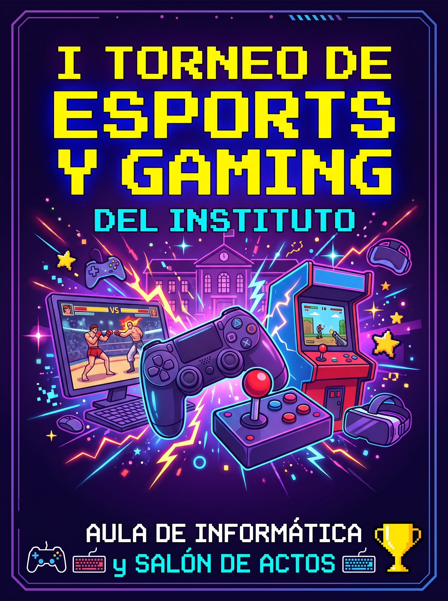

# 🎮 Torneo de eSports y Gaming del Instituto

## 1. Presentación y Configuración del Servidor

Bienvenidos a la página oficial del primer campeonato de videojuegos organizado por los alumnos de informática. Para garantizar que **ningún participante sufra lag** durante las partidas clasificatorias, hemos configurado un *servidor local dedicado* en el aula taller que se inicia ejecutando el comando `npm run start-tournament` desde la consola principal.

```python
# Script de emparejamiento automático del torneo (Matchmaking)
import random

equipos = ["Los Compiladores", "404 Not Found", "Ping Alto", "Sudo Winners"]
random.shuffle(equipos)

print(f"🔥 Semifinal 1: {equipos[0]} vs {equipos[1]}")
print(f"🔥 Semifinal 2: {equipos[2]} vs {equipos[3]}")
```

## 2. Equipamiento e Inscripción

**Material disponible en el salón de actos para los jugadores:**
* Ordenadores de sobremesa con monitores de 144Hz.
* Mandos clásicos y periféricos mecánicos a elección del alumno.
* Conexión por cable Ethernet de alta velocidad (Gigabit).

**Pasos obligatorios para registrar tu equipo en el torneo:**
1. Formar un equipo de entre 3 y 5 integrantes del centro.
2. Elegir un capitán y registrar el nombre del equipo en el formulario.
3. Confirmar la asistencia presencial 15 minutos antes de la primera ronda.

## 3. Enlaces Oficiales y Normativa

* **Web de referencia:** Consulta el reglamento estándar de competición en la página de la [Liga de Videojuegos Profesional (LVP)](https://lvp.global/) para conocer el formato de desempates.
* **Reglas internas y premios:** Revisa el listado de trofeos y las normas de convivencia en nuestro documento de [Detalles y Normativa del Torneo](docs/detalles.md).

## 4. Calendario y Cuadro de Competiciones

| Videojuego | Modalidad | Aula / Ubicación | Horario | Premios |
| :--- | :---: | :--- | :---: | :--- |
| Valorant / CS2 | 5 vs 5 (PC) | Aula de Informática 1 | 10:00 - 12:30 | Teclados mecánicos |
| Super Smash Bros. | 1 vs 1 (Consola) | Salón de Actos | 12:30 - 13:30 | Tarjetas regalo de 20€ |
| Street Fighter II (Retro) | Eliminatoria Directa | Zona Recreativa | 13:30 - 14:30 | Trofeo Pixel Art |

## 5. Cartel del Evento y Sede Oficial

### Cartel / Logotipo Local del Torneo
A continuación se muestra el diseño oficial del evento :



### Sede Presencial del Torneo (Wikimedia Commons)
Las finales se disputarán de forma presencial en las instalaciones de nuestro instituto:

